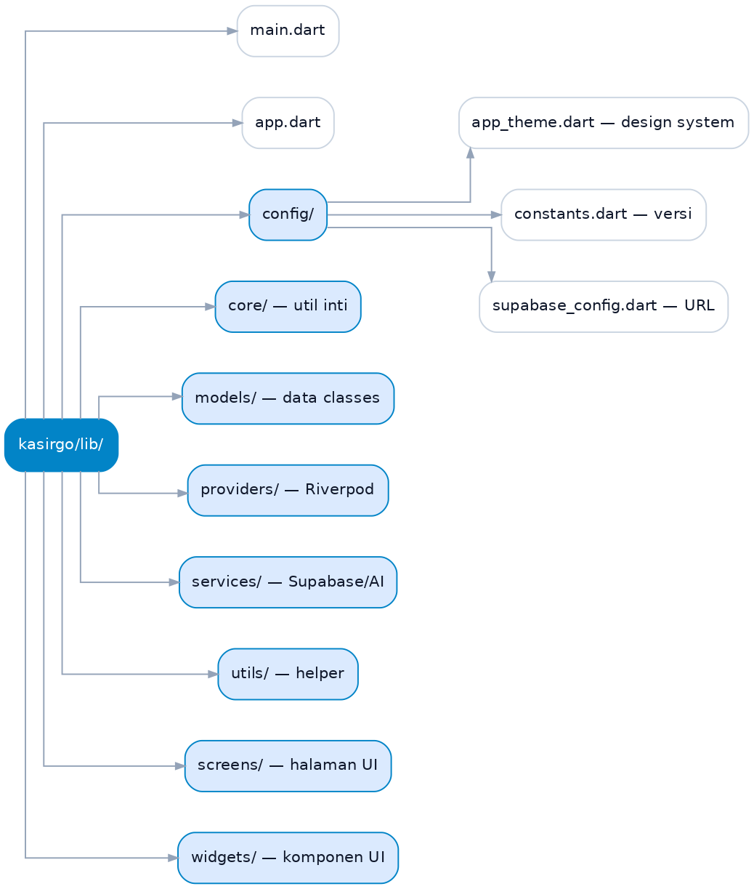
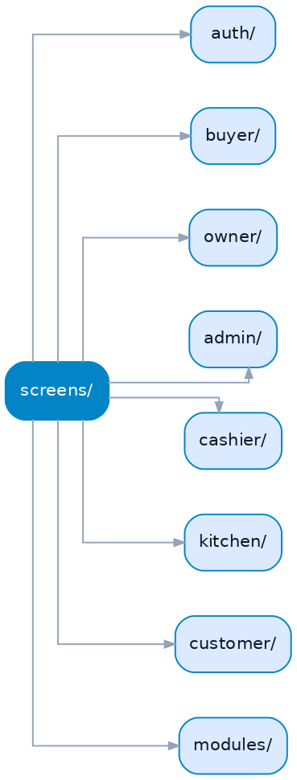
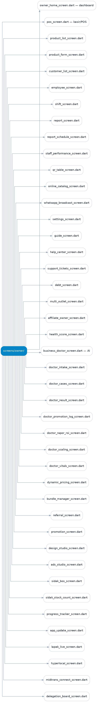
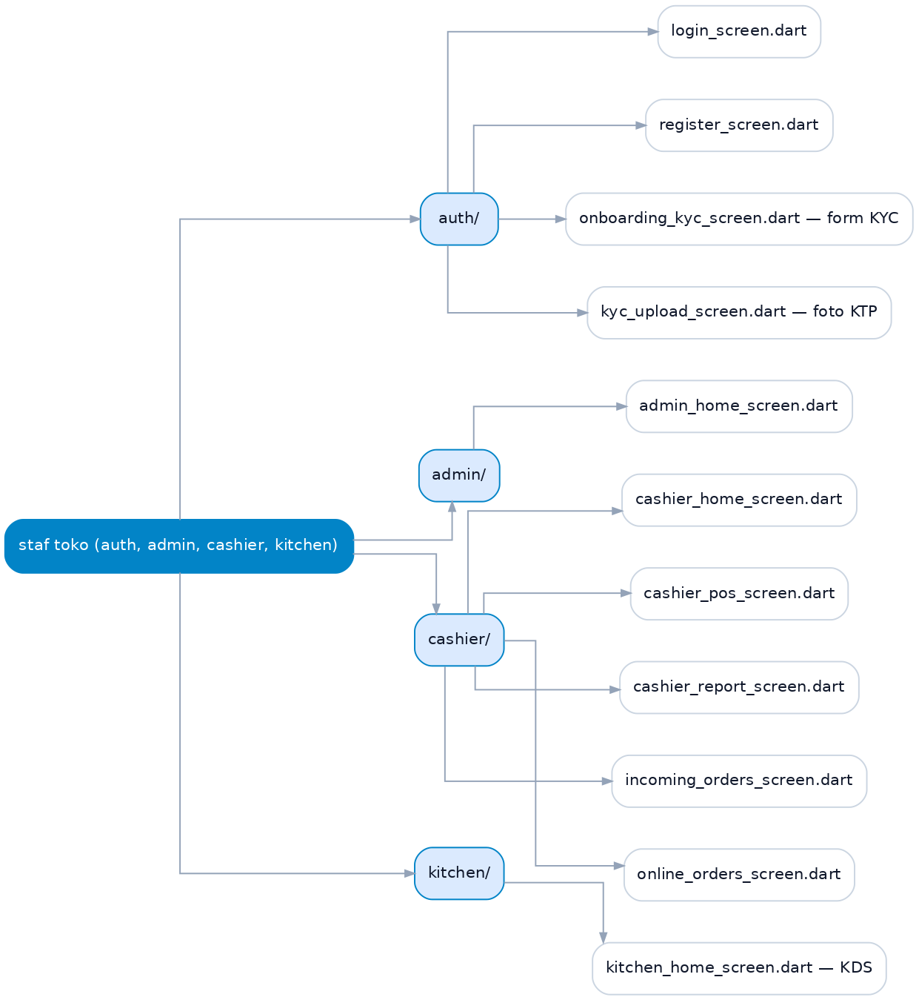
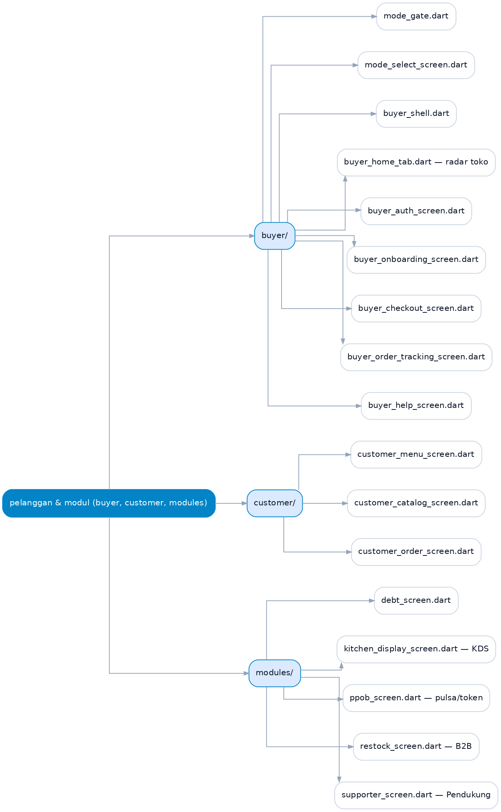
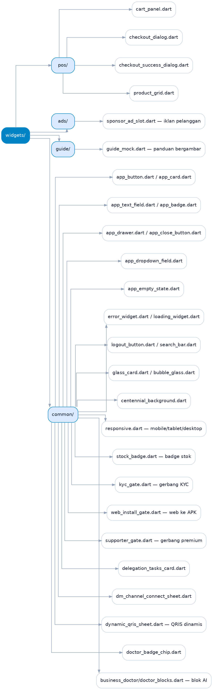

# Panduan Aplikasi KasirGo — Peran & Langkah Pemakaian

Panduan untuk pengguna aplikasi Android KasirGo: **Pemilik (Owner)**,
**Kasir**, **Admin**, **Koki**, dan **Pembeli (klien)**.

Struktur folder/UI ditampilkan sebagai gambar (PNG/SVG) di Lampiran. Sumber
diagram (Mermaid + Graphviz) tersimpan di `docs/diagrams/`.

---

## Bagian 1 — Link Unduh APK (v1.0.11, release-signed)

APK ditandatangani keystore resmi KasirGo (sama dengan 1.0.10), jadi bisa diinstall
langsung di atas versi lama **tanpa perlu uninstall** data.

| Perangkat | Ukuran | Link Unduh |
|-----------|--------|-----------|
| HP Android modern (arm64) — **Direkomendasikan** | ~57 MB | https://github.com/ikhlassabar2021-create/kasirgo/releases/download/v1.0.11-signed-20261103/kasirgo-1.0.11-arm64-v8a.apk |
| HP Android lama (armeabi-v7a) | ~46 MB | https://github.com/ikhlassabar2021-create/kasirgo/releases/download/v1.0.11-signed-20261103/kasirgo-1.0.11-armeabi-v7a.apk |
| Emulator / PC Intel (x86_64) | ~61 MB | https://github.com/ikhlassabar2021-create/kasirgo/releases/download/v1.0.11-signed-20261103/kasirgo-1.0.11-x86_64.apk |

Checksum (SHA-256) tersedia di:
https://github.com/ikhlassabar2021-create/kasirgo/releases/download/v1.0.11-signed-20261103/SHA256SUMS-1.0.11.txt

> Web aplikasi (cadangan ketika HP bermasalah): https://dokterbisnis.web.id/

---

## Bagian 2 — Panduan per Peran

### A. Pemilik (Owner)

**Fitur inti — gratis selamanya:**

1. **Daftar & masuk** (`register_screen.dart`, `login_screen.dart`) → sistem
   otomatis membuat outlet/toko.
2. **Verifikasi KYC** (`onboarding_kyc_screen.dart` + `kyc_upload_screen.dart`):
   nama sesuai KTP, no HP/email, alamat toko, foto KTP, foto selfie.
3. **Dashboard & AI Co-Pilot** (`owner_home_screen.dart`): ringkasan omzet hari ini,
   alert stok menipis/menumpuk, dan insight harian AI.
4. **Kelola produk** (`product_list_screen.dart` → `product_form_screen.dart`):
   nama, harga, stok, kategori, foto (lokal di HP), produk jasa/layanan.
5. **Kasir / POS** (`pos_screen.dart`): pilih produk → keranjang (`cart_panel.dart`)
   → bayar Tunai / QRIS statis / Transfer di `checkout_dialog.dart` → struk PDF/WA.
6. **Laporan penjualan** (`report_screen.dart`): laba rugi, omzet, per produk, plus
   `staff_performance_screen.dart`.
7. **Kelola pelanggan** (`customer_list_screen.dart`).
8. **Kelola karyawan** (`employee_screen.dart`), **shift** (`shift_screen.dart`),
   **delegasi tugas** (`delegation_board_screen.dart`).
9. **Paket Bundling** (`bundle_manager_screen.dart`).
10. **Afiliasi** (`affiliate_owner_screen.dart`): kode & komisi afiliasi.
11. **Kitchen (KDS)** (`kitchen_display_screen.dart`) — khusus usaha makanan/minuman
    (cafe/warteg).

**Fitur Program Pendukung (Rp50.000/bulan)** — dibuka lewat `supporter_screen.dart`:

- Dokter Bisnis AI (`business_doctor_screen.dart`)
- Sidak Stok & Kas (`sidak_bos_screen.dart`)
- Atur Harga & Diskon (`dynamic_pricing_screen.dart`)
- Laporan & Progres (`progress_tracker_screen.dart`)
- WA Marketing (`whatsapp_broadcast_screen.dart`)
- QR Meja Dine-in (`qr_table_screen.dart`) — khusus cafe/resto
- Katalog Online (`online_catalog_screen.dart`)

Beberapa fitur pendukung di Pengaturan: multi-outlet (`multi_outlet_screen.dart`),
custom struk/logo, laporan otomatis ke Bos, dan slot staf tambahan.

### B. Kasir

1. **Masuk** dengan akun kasir.
2. **Beranda** (`cashier_home_screen.dart`) → kartu **Pesanan Masuk** (badge).
3. **Jual di kasir** (`cashier_pos_screen.dart`): pilih produk, bayar, cetak struk.
4. **Pesanan masuk** (`incoming_orders_screen.dart` + `online_orders_screen.dart`):
   konfirmasi bayar pesanan dine-in/online.
5. **Laporan kasir** (`cashier_report_screen.dart`).

### C. Admin (Staf)

1. **Masuk** dengan akun admin.
2. **Beranda** (`admin_home_screen.dart`) → tab **Pesanan**, **POS**, **Laporan**.
3. **Tambah/edit produk** (tanpa hapus produk — hapus khusus Owner).
4. **Pantau pesanan masuk** (`incoming_orders_screen.dart`).
5. **Lihat laporan standar**.

### D. Koki (KDS / Dapur)

1. **Masuk** dengan akun koki → langsung ke layar **Dapur (KDS)**
   (`kitchen_home_screen.dart`).
2. Lihat antrean pesanan yang **sudah dibayar** kasir.
3. **Ubah status** pesanan (diproses → selesai).

### E. Pembeli (Klien)

1. Buka aplikasi → pilih mode **Pembeli** (`mode_gate.dart` → `mode_select_screen.dart`).
2. **Daftar/masuk** (`buyer_auth_screen.dart`) + isi identitas
   (`buyer_onboarding_screen.dart`).
3. **Cari toko terdekat** di radar (`buyer_home_tab.dart`, radius 3/5/10 km).
4. Buka katalog toko → **keranjang** → **Checkout** (`buyer_checkout_screen.dart`)
   (pilih Diantar/Ambil di toko).
5. **Lacak pesanan** realtime (`buyer_order_tracking_screen.dart`).
6. Panduan pembeli: `buyer_help_screen.dart`.

---

## Bagian 3 — Lampiran: Struktur Kode UI

Lokasi root aplikasi Flutter: `kasirgo/lib/`

> Catatan: diagram di bawah memetakan file kode apa adanya. Beberapa file layanan
> (mis. PPOB, B2B, fintech) masih ada di kode tapi **disembunyikan** dari dashboard
> owner. Daftar fitur yang tersedia untuk pengguna mengacu ke **Bagian 2**.

### 3.1 Peta folder utama



### 3.2 Screens (halaman) — dikelompokkan berdasarkan peran



**Folder `owner/` (halaman pemilik):**



**Folder `auth/`, `admin/`, `cashier/`, `kitchen/` (staf toko):**



**Folder `buyer/`, `customer/`, `modules/` (pelanggan & modul):**



### 3.3 Widgets (komponen reusable)



### Sumber diagram & cara render ulang

- **PNG / SVG** sudah jadi di folder `docs/diagrams/`.
- **Mermaid** (`*.mmd`) — untuk model AI, mermaid.live, dan GitHub.
- **Graphviz DOT** (`*.dot`) — untuk render ulang lokal.

```bash
python3 docs/tools/make_structure_images.py
```

---

## Catatan Rilis v1.0.11

- Deteksi ABI otomatis untuk pilih APK yang benar saat update.
- Helper di form KYC: "nama harus sama dengan KTP" + bypass validasi nama untuk
  akun uji (`@kasirgo.test` atau `is_qa`).
- Gerbang web→APK: HP jadi utama, web hanya cadangan.