# Panduan Aplikasi KasirGo — Link Unduh + Struktur UI + Langkah Demi Langkah

Dokumen ini rangkuman dari kode sumber (`kasirgo/lib/`) dan dirangkai menjadi
panduan pemakaian yang bisa langsung diikuti.

Struktur folder/UI digambar memakai **Mermaid** (diagram visual) sehingga bisa
langsung dirender menjadi gambar (PNG/SVG). Lihat catatan render di akhir Bagian 2.

---

## Bagian 1 — Link Unduh APK (v1.0.11, release-signed)

APK ditandatangani keystore resmi KasirGo (sama dengan 1.0.10), jadi bisa diinstall
langsung di atas versi lama **tanpa perlu uninstall** data.

| Perangkat | Ukuran | Link Unduh |
|-----------|--------|-----------|
| HP Android modern (arm64) — **Direkomendasikan** | ~57 MB | https://github.com/ikhlassabar2021-create/kasirgo/releases/download/v1.0.11-signed-20261103/kasirgo-1.0.11-arm64-v8a.apk |
| HP Android lama (armeabi-v7a) | ~46 MB | https://github.com/ikhlassabar2021-create/kasirgo/releases/download/v1.0.11-signed-20261103/kasirgo-1.0.11-armeabi-v7a.apk |
| Emulator / PC Intel (x86_64) | ~61 MB | https://github.com/ikhlassabar2021-create/kasirgo/releases/download/v1.0.11-signed-20261103/kasirgo-1.0.11-x86_64.apk |

Checksum (SHA-256) tersedia di:
https://github.com/ikhlassabar2021-create/kasirgo/releases/download/v1.0.11-signed-20261103/SHA256SUMS-1.0.11.txt

> Web aplikasi (cadangan ketika HP bermasalah): https://dokterbisnis.web.id/
> Dashboard superadmin: https://dokterbisnis.web.id/admin/

---

## Bagian 2 — Struktur Kode UI

Lokasi root aplikasi Flutter: `kasirgo/lib/`

### 2.1 Peta folder utama

```mermaid
flowchart TD
  root(["kasirgo/lib/"])
  root --> main["main.dart"]
  root --> app["app.dart"]
  root --> cfg["config/"]
  root --> core["core/"]
  root --> models["models/"]
  root --> providers["providers/"]
  root --> services["services/"]
  root --> utils["utils/"]
  root --> screens["screens/"]
  root --> widgets["widgets/"]

  main --> main1["entry point"]
  app --> app1["router GoRouter + wiring role + alert/tema"]
  cfg --> cfg1["app_theme.dart — design system Centennial"]
  cfg --> cfg2["constants.dart — versi + konstanta bisnis"]
  cfg --> cfg3["supabase_config.dart — URL + anon key"]
  core --> core1["util inti: pesan error, helper"]
  models --> models1["Product, Transaction, Customer, dll"]
  providers --> providers1["Riverpod state: currentUser, order badge"]
  services --> services1["Supabase, Sync, AI, Payment, dll"]
  utils --> utils1["ai_engine, wa_helper, pdf, geo, dll"]
  screens --> screens1["halaman UI — lihat 2.1"]
  widgets --> widgets1["komponen UI reusable — lihat 2.3"]
```



### 2.2 Screens (halaman) — dikelompokkan berdasarkan peran

```mermaid
flowchart TD
  S(["screens/"])
  S --> AU["auth/"]
  S --> BY["buyer/"]
  S --> OW["owner/"]
  S --> AD["admin/"]
  S --> CA["cashier/"]
  S --> KI["kitchen/"]
  S --> CU["customer/"]
  S --> MO["modules/"]

  subgraph GA["auth — login, daftar, KYC"]
    AU --> A1["login_screen.dart"]
    AU --> A2["register_screen.dart"]
    AU --> A3["onboarding_kyc_screen.dart — form KYC"]
    AU --> A4["kyc_upload_screen.dart — foto KTP + selfie"]
  end

  subgraph GB["buyer — mode pembeli"]
    BY --> B1["mode_gate.dart — ganti Penjual/Pembeli"]
    BY --> B2["mode_select_screen.dart"]
    BY --> B3["buyer_shell.dart — kerangka navigasi"]
    BY --> B4["buyer_home_tab.dart — radar toko"]
    BY --> B5["buyer_auth_screen.dart — login/daftar"]
    BY --> B6["buyer_onboarding_screen.dart — identitas"]
    BY --> B7["buyer_checkout_screen.dart"]
    BY --> B8["buyer_order_tracking_screen.dart"]
    BY --> B9["buyer_help_screen.dart"]
  end

  subgraph GO["owner — halaman pemilik"]
    OW --> O1["owner_home_screen.dart — dashboard"]
    OW --> O2["pos_screen.dart — kasir/POS"]
    OW --> O3["product_list_screen.dart — daftar produk"]
    OW --> O4["product_form_screen.dart — tambah/edit"]
    OW --> O5["customer_list_screen.dart — pelanggan"]
    OW --> O6["employee_screen.dart — karyawan & peran"]
    OW --> O7["shift_screen.dart — shift kasir"]
    OW --> O8["report_screen.dart — laporan keuangan"]
    OW --> O9["report_schedule_screen.dart — laporan otomatis"]
    OW --> O10["staff_performance_screen.dart — performa staf"]
    OW --> O11["qr_table_screen.dart — QR meja"]
    OW --> O12["online_catalog_screen.dart — katalog online/WA"]
    OW --> O13["whatsapp_broadcast_screen.dart — broadcast WA"]
    OW --> O14["settings_screen.dart — pengaturan"]
    OW --> O15["guide_screen.dart — panduan dalam app"]
    OW --> O16["help_center_screen.dart — pusat bantuan"]
    OW --> O17["support_tickets_screen.dart — tiket bantuan"]
    OW --> O18["debt_screen.dart — kasbon/piutang"]
    OW --> O19["multi_outlet_screen.dart — multi-outlet"]
    OW --> O20["affiliate_owner_screen.dart — afiliasi"]
    OW --> O21["health_score_screen.dart — skor kesehatan"]
    OW --> O22["business_doctor_screen.dart — Dokter Bisnis AI"]
    OW --> O23["doctor_intake_screen.dart — cek fisik toko"]
    OW --> O24["doctor_cases_screen.dart — riwayat konsultasi"]
    OW --> O25["doctor_result_screen.dart — hasil diagnosa"]
    OW --> O26["doctor_promotion_log_screen.dart — ROI"]
    OW --> O27["doctor_rapor_roi_screen.dart — rapor ROI"]
    OW --> O28["doctor_scaling_screen.dart — scaling"]
    OW --> O29["doctor_vitals_screen.dart — vital bisnis"]
    OW --> O30["dynamic_pricing_screen.dart — harga/diskon"]
    OW --> O31["bundle_manager_screen.dart — bundling"]
    OW --> O32["referral_screen.dart — kode referral"]
    OW --> O33["promotion_screen.dart — studio promosi"]
    OW --> O34["design_studio_screen.dart — studio desain"]
    OW --> O35["ads_studio_screen.dart — studio iklan"]
    OW --> O36["sidak_bos_screen.dart — sidak stok & kas"]
    OW --> O37["sidak_stock_count_screen.dart — stok fisik"]
    OW --> O38["progress_tracker_screen.dart — laporan & progres"]
    OW --> O39["app_update_screen.dart — cek pembaruan"]
    OW --> O40["lapak_live_screen.dart — radar live"]
    OW --> O41["hyperlocal_screen.dart — pasar hyperlocal"]
    OW --> O42["midtrans_connect_screen.dart — QRIS dinamis"]
    OW --> O43["delegation_board_screen.dart — delegasi tugas"]
  end

  subgraph GD["admin — staf toko"]
    AD --> D1["admin_home_screen.dart — tab pesanan, POS, laporan"]
  end

  subgraph GC["cashier — kasir"]
    CA --> C1["cashier_home_screen.dart — beranda"]
    CA --> C2["cashier_pos_screen.dart — POS"]
    CA --> C3["cashier_report_screen.dart — laporan"]
    CA --> C4["incoming_orders_screen.dart — pesanan masuk"]
    CA --> C5["online_orders_screen.dart — pesanan online"]
  end

  subgraph GK["kitchen — koki/dapur"]
    KI --> K1["kitchen_home_screen.dart — KDS layar dapur"]
  end

  subgraph GU["customer — sisi pelanggan"]
    CU --> U1["customer_menu_screen.dart — menu dine-in"]
    CU --> U2["customer_catalog_screen.dart — katalog publik"]
    CU --> U3["customer_order_screen.dart — status pesanan"]
  end

  subgraph GM["modules — lintas peran"]
    MO --> M1["debt_screen.dart — kasbon"]
    MO --> M2["kitchen_display_screen.dart — display dapur KDS"]
    MO --> M3["ppob_screen.dart — PPOB pulsa/token"]
    MO --> M4["restock_screen.dart — B2B kulakan"]
    MO --> M5["supporter_screen.dart — Program Pendukung"]
  end
```



### 2.3 Widgets (komponen reusable)

```mermaid
flowchart TD
  W(["widgets/"])
  W --> POS["pos/"]
  W --> ADS["ads/"]
  W --> GDE["guide/"]
  W --> COM["common/"]

  POS --> P1["cart_panel.dart"]
  POS --> P2["checkout_dialog.dart"]
  POS --> P3["checkout_success_dialog.dart"]
  POS --> P4["product_grid.dart"]

  ADS --> AD1["sponsor_ad_slot.dart — slot iklan pelanggan"]
  GDE --> GD1["guide_mock.dart — simulasi panduan bergambar"]

  COM --> CM1["app_button.dart / app_card.dart"]
  COM --> CM2["app_text_field.dart / app_badge.dart"]
  COM --> CM3["app_drawer.dart / app_close_button.dart"]
  COM --> CM4["app_dropdown_field.dart"]
  COM --> CM5["app_empty_state.dart / empty_state_widget.dart"]
  COM --> CM6["error_widget.dart / loading_widget.dart"]
  COM --> CM7["logout_button.dart / search_bar.dart"]
  COM --> CM8["glass_card.dart / bubble_glass.dart"]
  COM --> CM9["centennial_background.dart"]
  COM --> CM10["responsive.dart — mobile/tablet/desktop"]
  COM --> CM11["stock_badge.dart — badge stok"]
  COM --> CM12["kyc_gate.dart — gerbang KYC"]
  COM --> CM13["web_install_gate.dart — gerbang web ke APK"]
  COM --> CM14["supporter_gate.dart — gerbang premium"]
  COM --> CM15["delegation_tasks_card.dart — kartu tugas"]
  COM --> CM16["dm_channel_connect_sheet.dart"]
  COM --> CM17["dynamic_qris_sheet.dart — QRIS dinamis"]
  COM --> CM18["doctor_badge_chip.dart"]
  COM --> CM19["business_doctor/doctor_blocks.dart — blok jawaban AI"]
```



### Cara render Mermaid menjadi gambar

Mermaid bisa dirender jadi PNG/SVG tanpa bantuan model lain:

1. **Otomatis di GitHub** — buka berkas ini di GitHub, blok ` ```mermaid `
   otomatis tampil sebagai diagram.
2. **mermaid.live** — salin isi blok diagram ke https://mermaid.live/ lalu
   **Export** PNG/SVG.
3. **Lokal via CLI**:
   ```bash
   npx -y @mermaid-js/mermaid-cli -i diagram.mmd -o diagram.png
   ```
4. **Untuk model/gambar**: beri model teks sumber Mermaid (bukan ASCII tree),
   minta ia menghasilkan diagram, lalu render ke gambar — model jauh lebih akurat
   karena Mermaid punya struktur node/edge yang jelas.

---

## Bagian 3 — Panduan Langkah Demi Langkah

### A. Instalasi & Akun Baru

1. **Unduh APK** sesuai perangkat (link di Bagian 1). Untuk HP modern pakai
   `arm64-v8a`; jika gagal install/cepat crash coba `armeabi-v7a`.
2. **Buka aplikasi** → layar pemilihan mode **Penjual / Pembeli**
   (`mode_select_screen.dart`). Pilih **Penjual** untuk kelola toko.
3. **Daftar akun** (`register_screen.dart`): isi email, password, nama usaha,
   tipe usaha. Konfirmasi lewat email.
4. **Login** (`login_screen.dart`) → sistem otomatis membuat outlet.
5. **Verifikasi KYC** (`onboarding_kyc_screen.dart` + `kyc_upload_screen.dart`):
   nama sesuai KTP, no HP/email, alamat toko, foto KTP, foto selfie. KYC otomatis
   diverifikasi. (Akun uji `qa.gate@kasirgo.test` bisa melewati cek nama.)

### B. Siapkan Produk & Stok (Owner/Admin)

1. Buka **Produk** (`product_list_screen.dart`).
2. **Tambah produk** (`product_form_screen.dart`): nama, harga, stok, kategori,
   foto (foto disimpan lokal di HP), produk jasa/layanan (tanpa stok).
3. Kelola **stok** langsung dari daftar produk.

### C. Jual di Kasir (POS)

1. Owner: buka **POS** (`pos_screen.dart`) — Kasir: `cashier_pos_screen.dart`.
2. Pilih produk → masuk keranjang (`cart_panel.dart`) → **Bayar**.
3. Pilih metode bayar (Tunai / QRIS / Transfer) di `checkout_dialog.dart`.
4. Setelah sukses muncul `checkout_success_dialog.dart` dengan tombol **Struk
   PDF / Struk ke WA**.

### D. Pesanan Dine-in & QR Meja (cafe/resto)

1. Owner: siapkan **QR Meja** (`qr_table_screen.dart`) → cetak/salin QR.
2. Pelanggan scan QR → `customer_menu_screen.dart` → pilih menu → kirim
   (`customer_order_screen.dart` menampilkan status).
3. Kasir konfirmasi bayar di **Pesanan Masuk** (`incoming_orders_screen.dart`).
4. Koki melihat & mengubah status di **KDS** (`kitchen_home_screen.dart`).

### E. Katalog Online & WhatsApp

1. Owner: aktifkan **Katalog Online** (`online_catalog_screen.dart`).
2. Promosi via **Broadcast WA** (`whatsapp_broadcast_screen.dart`).

### F. Laporan & Keuangan

1. **Laporan** (`report_screen.dart`): laba rugi, penjualan, per produk (SAK EMKM).
2. Ekspor **Excel** & **PDF** dari tombol di layar laporan.
3. **Laporan performa staf** (`staff_performance_screen.dart`).
4. **Laporan otomatis ke bos** (`report_schedule_screen.dart`).

### G. Karyawan, Shift & Delegasi

1. **Karyawan** (`employee_screen.dart`): tambah Admin / Kasir / Koki
   (+ kuota staf gratis 1 Admin + 1 Kasir).
2. **Shift** (`shift_screen.dart`): atur shift & tip.
3. **Delegasi tugas** (`delegation_board_screen.dart`) + pengingat otomatis.

### H. Dokter Bisnis AI (Program Pendukung)

1. Beranda → kartu **Dokter Bisnis AI** (`business_doctor_screen.dart`).
2. Ikuti **Cek Fisik Toko** (`doctor_intake_screen.dart`).
3. Baca **Hasil Diagnosa** (`doctor_result_screen.dart`), jalankan resep.
4. Catat hasil promosi & ROI (`doctor_promotion_log_screen.dart`), lihat
   riwayat (`doctor_cases_screen.dart`).

### I. Fitur Pertumbuhan (AI / Marketing)

1. **Atur Harga & Diskon** (`dynamic_pricing_screen.dart`).
2. **Bundling produk** (`bundle_manager_screen.dart`).
3. **Referral pelanggan** (`referral_screen.dart`).
4. **Squad Marketing** (`design_studio_screen.dart`, `promotion_screen.dart`,
   `ads_studio_screen.dart`).
5. **Sidak Stok & Kas** (`sidak_bos_screen.dart`).

### J. Pasar Hyperlocal (mode Pembeli)

1. Ganti mode ke **Pembeli** (`mode_gate.dart`).
2. Login/daftar pembeli (`buyer_auth_screen.dart`) + isi identitas
   (`buyer_onboarding_screen.dart`).
3. Radar toko terdekat (`buyer_home_tab.dart`) → pilih toko → katalog.
4. **Checkout** (`buyer_checkout_screen.dart`) → **Lacak pesanan**
   (`buyer_order_tracking_screen.dart`).

### K. Bantuan & Pembaruan

1. **Pusat Bantuan** (`help_center_screen.dart`) + **Tiket** (`support_tickets_screen.dart`).
2. **Cek pembaruan** (`app_update_screen.dart`).
3. **Program Pendukung** (`supporter_screen.dart`) untuk fitur premium
   (Rp50.000/bulan).

---

## Catatan Rilis v1.0.11

- Deteksi ABI otomatis untuk pilih APK yang benar saat update.
- Helper di form KYC: "nama harus sama dengan KTP" + bypass validasi nama untuk
  akun uji (`@kasirgo.test` atau `is_qa`).
- Gerbang web→APK: HP jadi utama, web hanya cadangan.